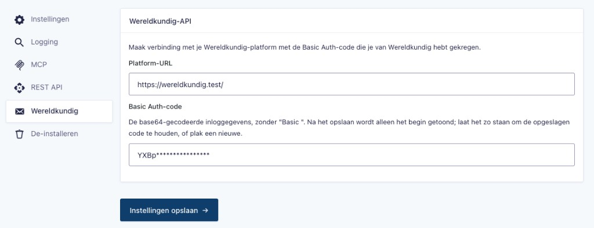

The add-on connects to your Wereldkundig platform with a URL and a Basic Auth code. Wereldkundig supplies both.

## Enter the credentials

Go to **Forms > Settings > Wereldkundig** and fill in:

- **Platform URL**: the platform domain or full URL, e.g. `https://subdomein.domein.nl`. `https://` is assumed when you leave it out, and `/wp-json/wereldkundig` is added when it's missing.
- **Basic Auth code**: the base64 code, without `Basic ` in front. A leading `Basic ` is removed anyway.

Then click **Save**. Saving fetches the themes and subscriber fields from the platform straight away, so you know right away whether the connection works.



:::note
The URL must start with `https://`. The Basic Auth code is sent with every request, so plain `http://` is refused. For local development it is allowed for `localhost`, `*.localhost` and `*.test`.
:::

## Connection status

The top of the settings page shows the state of the connection. It shows the result of the last fetch and doesn't contact the platform itself.

- **Successfully connected to Wereldkundig.** with the platform, the number of themes and when they were fetched.
- A red notice when the last fetch failed, with its time and error message:
  - **Settings saved, but the Wereldkundig API call failed.** after saving the settings;
  - **The background refresh of the Wereldkundig themes failed.** after the [hourly refresh](/guides/themes-and-refresh/).

  The notice stays until a fetch succeeds. The themes fetched before keep working in the meantime.
- Nothing, before the settings are saved for the first time.

The Wereldkundig feed page of a form shows the same red notice. Without credentials it asks you to enter them first.

## The Basic Auth code stays hidden

Once saved, the field only shows the start of the code followed by asterisks.

- Leave the masked value as it is to keep the saved code.
- Paste a new code to replace it.
- Empty the field to remove it.

The settings are stored like those of other Gravity Forms add-ons. Gravity Forms 2.7.17 and later encrypt them when `GF_ENCRYPTION_KEY` is defined in `wp-config.php`. Without that key the code is stored as plain text in the database. To keep it out of the database entirely, use constants.

## Credentials in wp-config.php

```php
define('WK_GF_API_URL', 'https://subdomein.domein.nl');
define('WK_GF_API_AUTH', 'base64code');
```

Each constant wins over its field on the settings page. The settings page then says which constants are defined, and the Basic Auth field becomes read-only and shows the masked constant.

On multisite, constants in `wp-config.php` apply to every site in the network.

With constants, save the settings page once to fetch the themes right away. Otherwise the background refresh fetches them about an hour after the next admin page load.
