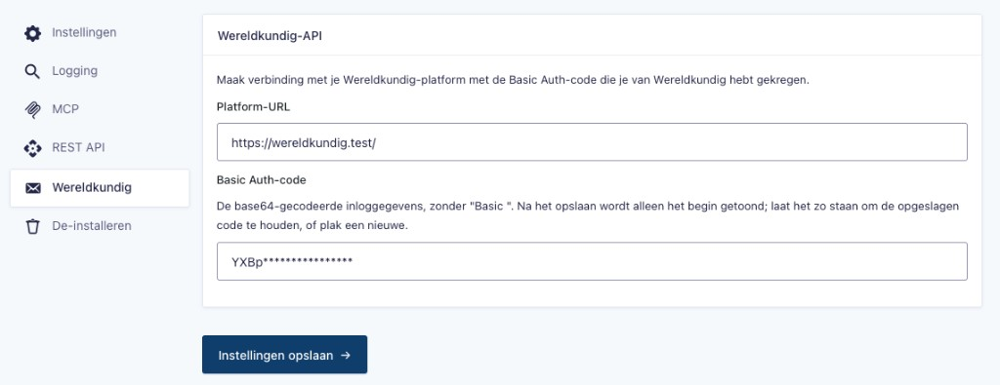

De add-on maakt verbinding met je Wereldkundig-platform via een URL en een Basic Auth-code. Je krijgt ze allebei van Wereldkundig.

## De gegevens invullen

Ga naar **Formulieren > Instellingen > Wereldkundig** en vul in:

- **Platform-URL**: het domein of de volledige URL van het platform, bijvoorbeeld `https://subdomein.domein.nl`. Laat je `https://` weg, dan wordt het aangenomen, en `/wp-json/wereldkundig` wordt toegevoegd als het ontbreekt.
- **Basic Auth-code**: de base64-code, zonder `Basic ` ervoor. Staat er toch `Basic ` voor, dan wordt dat weggehaald.

Klik daarna op **Instellingen opslaan**. Bij het opslaan worden de thema's en abonneevelden meteen van het platform opgehaald, zodat je direct ziet of de verbinding werkt.



:::note
De URL moet met `https://` beginnen. De Basic Auth-code gaat met elk verzoek mee, dus gewoon `http://` wordt geweigerd. Voor lokale ontwikkeling mag het wel voor `localhost`, `*.localhost` en `*.test`.
:::

## Verbindingsstatus

Bovenaan de instellingenpagina staat de toestand van de verbinding. Dat is het resultaat van de laatste keer ophalen; de pagina neemt zelf geen contact op met het platform.

- **Verbinding met Wereldkundig gelukt.** met het platform, het aantal thema's en wanneer ze zijn opgehaald.
- Een rode melding als het laatste ophalen mislukte, met het tijdstip en de foutmelding:
  - **Instellingen opgeslagen, maar de aanroep van de Wereldkundig-API is mislukt.** na het opslaan van de instellingen;
  - **Het verversen van de Wereldkundig-thema's op de achtergrond is mislukt.** na de [verversing van elk uur](/nl/guides/themes-and-refresh/).

  De melding blijft staan tot het ophalen weer lukt. De eerder opgehaalde thema's blijven ondertussen werken.
- Niets, zolang de instellingen nog nooit zijn opgeslagen.

De Wereldkundig-feedpagina van een formulier toont dezelfde rode melding. Zonder gegevens vraagt die pagina je eerst om ze in te vullen.

## De Basic Auth-code blijft verborgen

Na het opslaan toont het veld alleen het begin van de code, gevolgd door sterretjes.

- Laat de gemaskeerde waarde staan om de opgeslagen code te houden.
- Plak een nieuwe code om hem te vervangen.
- Maak het veld leeg om hem te verwijderen.

De instellingen worden opgeslagen zoals die van andere Gravity Forms-add-ons. Gravity Forms 2.7.17 en nieuwer versleutelt ze als `GF_ENCRYPTION_KEY` in `wp-config.php` staat. Zonder die sleutel staat de code als leesbare tekst in de database. Wil je hem helemaal buiten de database houden, gebruik dan constanten.

## Gegevens in wp-config.php

```php
define('WK_GF_API_URL', 'https://subdomein.domein.nl');
define('WK_GF_API_AUTH', 'base64code');
```

Elke constante gaat voor op het bijbehorende veld op de instellingenpagina. De instellingenpagina laat dan zien welke constanten zijn gedefinieerd, en het veld voor de Basic Auth-code wordt alleen-lezen en toont de gemaskeerde constante.

Op multisite gelden constanten in `wp-config.php` voor alle sites in het netwerk.

Sla met constanten de instellingenpagina één keer op om de thema's meteen op te halen. Anders haalt de verversing op de achtergrond ze op, ongeveer een uur na het eerstvolgende bezoek aan een beheerpagina.
