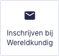

1. Open een formulier in de formuliereditor. Het heeft een veld **E-mailadres** nodig.
2. Voeg een veld **Inschrijven bij Wereldkundig** toe uit de groep **Standaardvelden**.
3. Pas het veldlabel aan. Dat is de tekst naast het vinkje, dus vervang "Inschrijven bij Wereldkundig" door iets als "Ja, stuur mij de nieuwsbrief".

4. Sla het formulier op. Ga naar **Formulierinstellingen > Wereldkundig** en voeg een feed toe.
5. Vink in de feed onder **Thema's** een of meer thema's aan. Staat er meer dan één inschrijfveld op het formulier, kies dan ook het veld onder **Inschrijfvinkje**. Vink categorieën van een thema aan om alleen daarvoor in te schrijven.
6. Kies onder **Velden koppelen** het veld E-mailadres voor het e-mailadres. Sla de feed op.
7. Open het formulier en verstuur het met het vinkje aan.
8. Open de inzending. De notities vertellen of de abonnee is verstuurd, bijvoorbeeld: **reader@example.com is naar Wereldkundig verstuurd. Thema's: Nieuwsbrief.**

De feed verstuurt de abonnee, op de achtergrond direct na het versturen. Zonder feed wordt er niets verstuurd.

In dezelfde [feed](/nl/guides/feeds-and-mapping/) kun je meer velden koppelen, zoals de naam, en voorwaardelijke logica toevoegen.

:::tip
Toont de feed **De thema's van Wereldkundig konden niet worden geladen.** in plaats van de thema's? [Koppel](/nl/getting-started/connect/) dan eerst het platform, of sla de instellingen op om de thema's opnieuw op te halen.
:::
